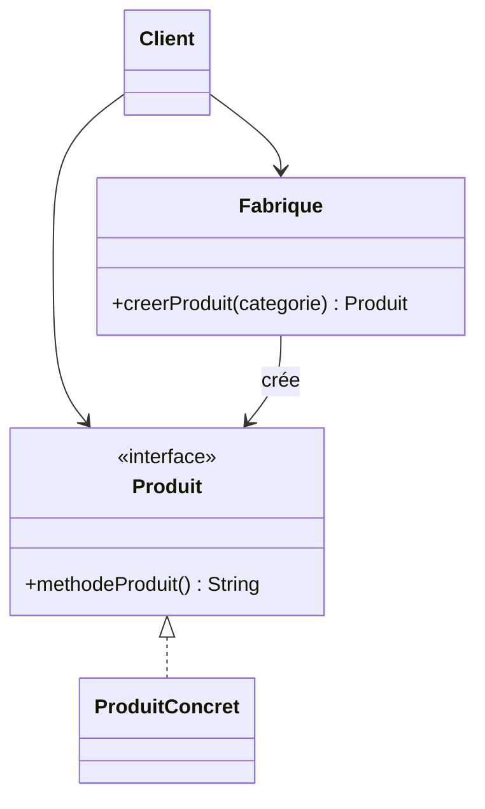
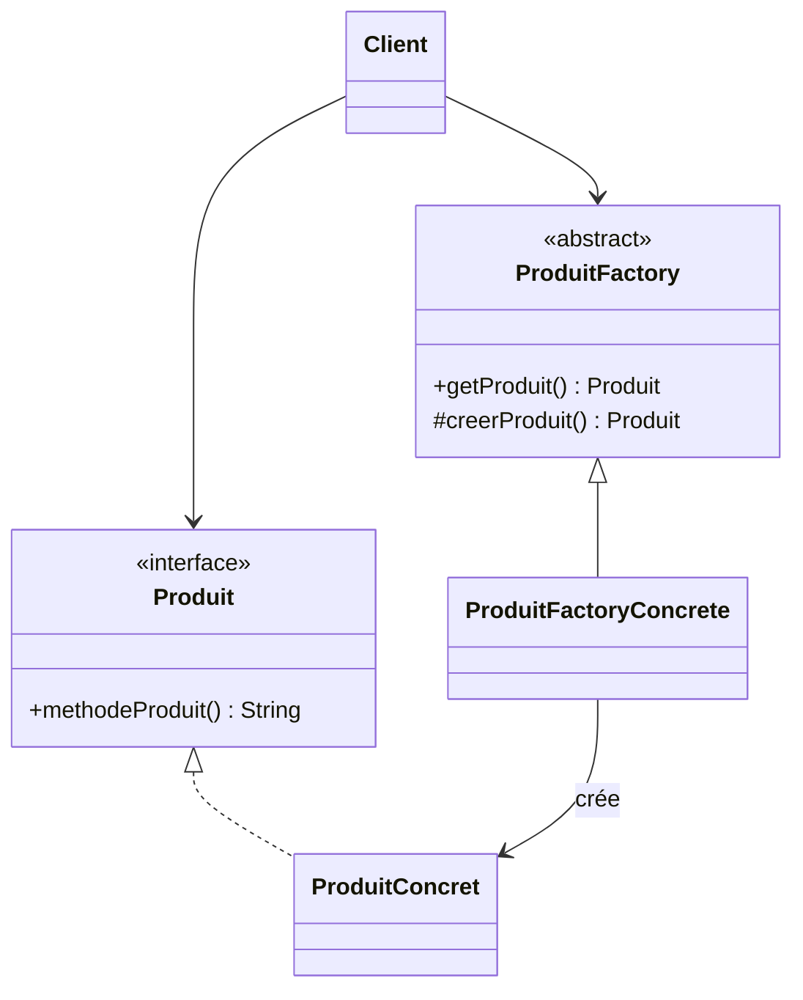

# Rapport - Factory Method et Factory

**Étudiant :** KOA ESSAMA PAULIN BRICE  
**Matricule :** 25I2255  
**UE :** INF461 - Patrons de construction

## 1. Factory Method

Dans cette version, `FabriqueProduit` reçoit une catégorie à l'exécution et retourne une instance de `ProduitA`, `ProduitB` ou `ProduitC`. Le client dépend seulement de l'interface `Produit`.

### Modèle générique

L'exemple du support comporte `ProduitA`, `ProduitB` et `ProduitC`. La version modifiée ajoute `ProduitD` et le cas `"D"` dans `FabriqueProduit`.

## 2. Factory

`ProduitFactory` définit l'opération de création. Chaque sous-classe de la fabrique décide du produit concret à instancier : `ProduitFactoryA` crée `ProduitA`, et ainsi de suite.

### Modèle générique

L'exemple initial contient les produits et fabriques A, B et C. La version modifiée ajoute `ProduitD` et `ProduitFactoryD` sans modifier le client.

## 3. Exécution

Les quatre programmes affichent les produits créés. Les commandes sont indiquées dans le fichier `README.md` à la racine du projet.

## 4. Dépôt GitHub

Le projet est disponible publiquement sur : https://github.com/eliote-geeks/devoir-inf461-patrons-construction-koa-essama-paulin-brice

